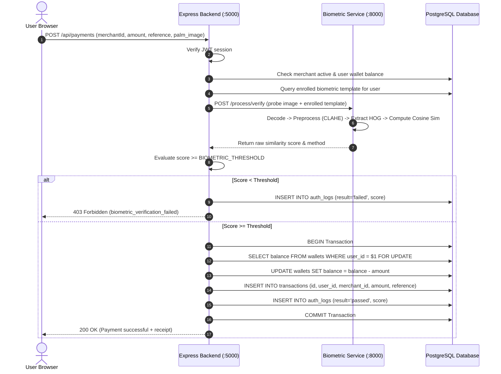

# PalmPay System Architecture

## 1. System Overview

PalmPay is an academic prototype evaluating palm-vein biometric verification integrated into a simulated closed-loop payment system.

```text
+-------------------------------------------------------------+
|                      Client Browser                         |
|  React (Vite) Single-Page Application (localhost:5173)      |
+-------------------------------------------------------------+
                              |
                              | HTTPS / JSON / Multipart
                              v
+-------------------------------------------------------------+
|                  Express Backend API (Port 5000)            |
| - Authentication & Token Signing (bcrypt + JWT)             |
| - Authorization & Business Logic Orchestration              |
| - Parameterized SQL queries via PostgreSQL pool             |
| - Biometric threshold evaluation (server-side)              |
+-------------------------------------------------------------+
          |                                       |
          | Internal HTTP                         | SQL Transactions
          | (localhost:8000)                      | (SELECT ... FOR UPDATE)
          v                                       v
+---------------------------------+   +-----------------------+
|   Python Biometric Service      |   |   PostgreSQL Database |
|   (FastAPI + OpenCV)            |   |                       |
| - Grayscale & CLAHE & Blur      |   | - users               |
| - HOG Feature Extraction        |   | - biometric_templates |
| - Cosine Similarity Scoring     |   | - wallets             |
| * Stateless (No DB writes)      |   | - merchants           |
| * No Payment Authorization      |   | - transactions        |
+---------------------------------+   | - auth_logs           |
                                      +-----------------------+
```

## 2. Core Architectural Principles

### Strict Service Boundaries
1. **Express is the Sole Orchestrator:**
   The frontend communicates only with the Express API. It cannot directly query PostgreSQL or interact directly with the Python biometric microservice.
2. **Client Never Authorizes Payment:**
   The browser never submits a `matched=true` flag to trigger a payment. Biometric verification occurs strictly server-to-server: Express receives the uploaded probe image, forwards it to FastAPI, receives the raw similarity score, compares it to the configured threshold, and decides whether to authorize the payment.
3. **Stateless Biometric Microservice:**
   The Python FastAPI service does not connect to the database, does not hold user records, and does not update wallet balances. It operates strictly as an image-processing and vector-scoring worker.
4. **Closed-Loop Simulation:**
   No live bank networks, UPI APIs, or payment gateways are used. All wallets are internal virtual ledgers initialized with demo credits.

## 3. Request Flow: Biometric Payment Checkout



## 4. Threat Model & Mitigations

| Threat | Risk | Mitigation |
|---|---|---|
| Client forgery of biometric verdict | Unauthorized debit | The browser cannot pass verification flags; Express orchestrates FastAPI comparison. |
| Concurrent double-spend | Wallet overdraft | SQL transaction with `SELECT ... FOR UPDATE` row-level locking. |
| Duplicate payment submission | Multiple charges | Client generates UUID idempotency `reference`; DB enforces unique constraint. |
| Credential disclosure | Password breach | bcrypt hashing with minimum 12 rounds; passwords excluded from API responses. |
| SQL Injection | Data exfiltration | Parameterized SQL queries (`$1, $2`) via `pg` library. |
| Arbitrary file upload | RCE / Resource exhaustion | Server-side MIME check (`image/png`, `image/jpeg`) and 5MB size limit. |
