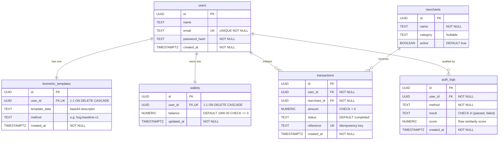

# PalmPay Database Specification

## 1. Relational Entity-Relationship (ER) Diagram

### Visual Mermaid Diagram


### ASCII Structural Diagram
```text
       +-------------------------+
       |          users          |
       +-------------------------+
       | id (PK, UUID)           |<-------+
       | name                    |        |
       | email (UNIQUE)          |        |
       | password_hash           |        |
       | created_at              |        |
       +-------------------------+        |
         | 1                     | 1      |
         |                       |        |
         v 1                     v 1      |
+---------------------+ +---------------+ |
| biometric_templates | |    wallets    | |
+---------------------+ +---------------+ |
| id (PK, UUID)       | | id (PK, UUID) | |
| user_id (FK, UNIQUE)| | user_id (FK,U)| |
| template_data       | | balance (>= 0)| |
| method              | | updated_at    | |
| created_at          | +---------------+ |
+---------------------+                   |
                                          |
         +--------------------------------+
         | 1                      | 1
         |                        |
         v M                      v M
+----------------------+ +--------------------+
|     transactions     | |     auth_logs      |
+----------------------+ +--------------------+
| id (PK, UUID)        | | id (PK, UUID)      |
| user_id (FK)         | | user_id (FK)       |
| merchant_id (FK)     | | method             |
| amount (> 0)         | | result (pass/fail) |
| status               | | score (NUMERIC)    |
| reference (UNIQUE)   | | created_at         |
| created_at           | +--------------------+
+----------------------+
         | M
         |
         v 1
+--------------------+
|     merchants      |
+--------------------+
| id (PK, UUID)      |
| name               |
| category           |
| active (BOOLEAN)   |
+--------------------+
```

---

## 2. Table Definitions & Constraints

### `users`
- Primary identity table for accounts.
- `id`: UUID surrogate primary key generated automatically via `gen_random_uuid()`.
- `email`: Enforced unique (`UNIQUE NOT NULL`), case-insensitive in application logic.
- `password_hash`: Salted bcrypt hash with cost factor $\ge 12$. Plaintext is never stored.

### `biometric_templates`
- Stores serialized feature vectors extracted from NIR palm-vein images.
- `UNIQUE (user_id)` ensures each account maintains exactly one active template (1:1 relationship).
- Re-enrollments execute an `ON CONFLICT (user_id) DO UPDATE` to update templates atomically.
- `ON DELETE CASCADE`: Deleting a user automatically deletes their template.

### `wallets`
- Closed-loop virtual balance for demo purposes.
- Initialized with `1000.00` upon registration.
- `UNIQUE (user_id)` enforces a strict 1:1 relationship with the user.
- `CHECK (balance >= 0)` ensures the database engine strictly prevents overdrafts regardless of application state.
- `ON DELETE CASCADE`: Deleting a user automatically removes their wallet.

### `merchants`
- Simulated vendors for payment checkout testing.
- `active`: Boolean flag allowing merchants to be disabled without breaking foreign key history.

### `transactions`
- Financial ledger of completed debits.
- `amount`: Constrained to positive values (`CHECK (amount > 0)`).
- `reference`: Unique idempotency key supplied by the client during payment submission to prevent double-charging on network retries.
- Foreign keys link to `users(id)` and `merchants(id)`.

### `auth_logs`
- Independent audit log for every biometric verification attempt.
- `result`: Restricted via `CHECK (result IN ('passed', 'failed'))`.
- `score`: Stores the raw float similarity value for post-evaluation and threshold auditing.

---

## 3. Concurrency & Transaction Safety

When processing payments, the backend executes an atomic PostgreSQL transaction:
```sql
BEGIN;
SELECT balance FROM wallets WHERE user_id = $1 FOR UPDATE;
-- Verify balance >= amount
UPDATE wallets SET balance = balance - $2, updated_at = now() WHERE user_id = $1;
INSERT INTO transactions (id, user_id, merchant_id, amount, status, reference)
VALUES ($3, $1, $4, $2, 'completed', $5);
COMMIT;
```
The `SELECT ... FOR UPDATE` acquires an exclusive row-level lock on the user's wallet record, eliminating race conditions and double-spending across concurrent requests.

---

## 4. Query Performance Indexes

In addition to primary key and unique constraint indexes, secondary indexes are configured for high-traffic query access paths:
- `idx_transactions_user_id`: Index on `transactions(user_id)` for rapid user transaction history retrieval.
- `idx_transactions_created`: B-tree index on `transactions(created_at DESC)` for pagination and sorting.
- `idx_auth_logs_user_id`: Index on `auth_logs(user_id)` for user audit logs.
- `idx_auth_logs_created`: Index on `auth_logs(created_at DESC)` for audit timeline filtering.
